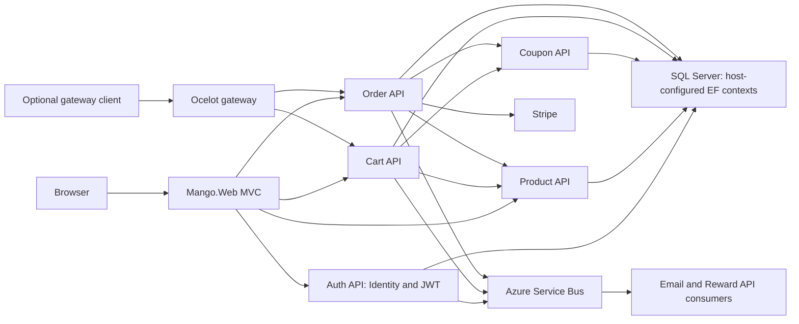
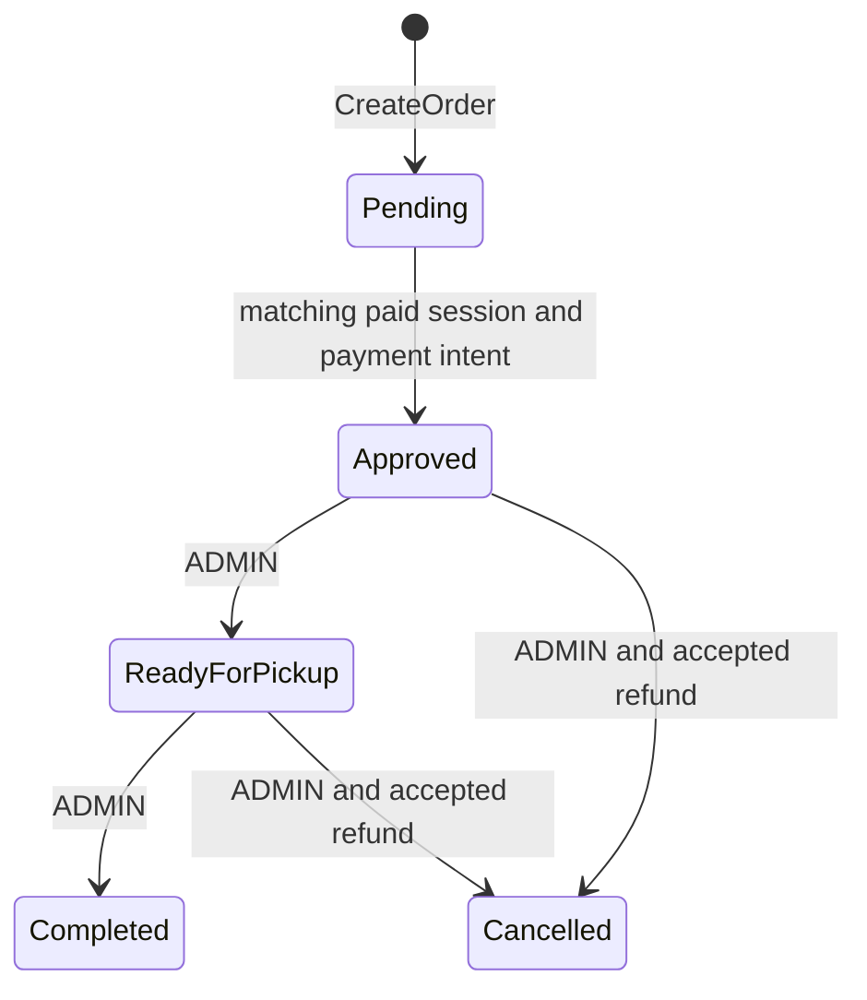

# Architecture: catalog, cart and order boundaries

[Walkthrough](WALKTHROUGH.md) · [Repository overview](../README.md) · [Access and payment policy](../SECURITY-SETUP.md)

This map describes the checked-in implementation. It is not a diagram of a verified deployment.

The MVC service adapters use their configured service base URLs. The optional gateway is a separate entry point; this diagram does not imply that every MVC request passes through it. Other gateway routes are listed in [ocelot.json](../Mango.GatewaySolution/ocelot.json). The SQL node groups host-configured contexts, rather than claiming one shared database or an independently deployed database per service.

## Choices visible in the code

| Choice | Implementation and consequence |
|---|---|
| Separate API hosts | Each API has its own Program and EF context. Service URLs, JWT validation and database targets must agree when running the hosts together. See [service map](../README.md#service-map). |
| Server-owned identity | [Cart controller](../Mango.Services.ShoppingCartAPI/Controllers/CartAPIController.cs) binds writes to the JWT subject. [Order controller](../Mango.Services.OrderAPI/Controllers/OrderAPIController.cs) reads persisted ownership before payment access; ADMIN order reads do not grant payment impersonation. |
| Price snapshot at order creation | Order API loads the catalog and coupon terms, rounds units using decimal arithmetic and stores order lines. Later checkout uses those persisted lines. This limits client price tampering and keeps an existing order's amount separate from subsequent catalog edits. |
| Synchronous pricing dependencies | The [product client](../Mango.Services.OrderAPI/Service/ProductService.cs) must provide the catalog before order creation; the [coupon client](../Mango.Services.OrderAPI/Service/CouponService.cs) must provide terms when a coupon is requested. Pricing availability therefore depends on the relevant upstream APIs. |
| Asynchronous notifications | Registration, cart email and order rewards publish through [Mango.MessageBus](../Mango.MessageBus/MessageBus.cs). Publishers and consumers require separately configured messaging entities. |
| Provider retry keys | Checkout/discount/refund requests use stable per-order Stripe idempotency keys; matching open checkout sessions are reused. These keys do not create a SQL/Stripe/Service Bus transaction. |

## Order lifecycle

Repeated sequential confirmation of an already paid operational state returns that state without publishing another reward message. Repeating the same operational status is a no-op. Pending cannot be marked Completed by an administrator. Refunded exists as a constant but is not an allowed operational target in this controller.

## Practical limits

Approval is saved before reward publication; a failed publication needs reconciliation. There is no transactional outbox or exactly-once guarantee, and concurrent requests are not serialized. Accepted pending refunds are not followed through settlement. Zero-total orders cannot start the current payment flow. The in-memory suite does not establish SQL concurrency or live Stripe interoperability.

These limits, rounding/coupon rules and HTTP failures are specified in [SECURITY-SETUP.md](../SECURITY-SETUP.md#cart-pricing-and-order-workflow). Runtime/package modernization is separate work.
